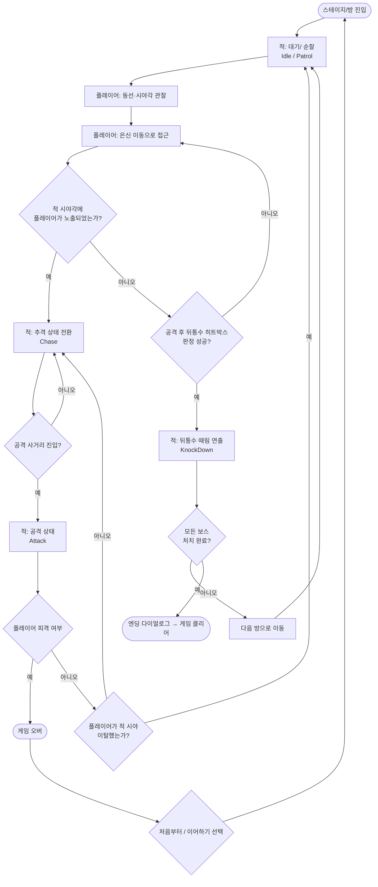

# Watch Your Back 게임 업데이트 기획서

## 1. 현행버전 회고
### 1.1 게임 장르: 2D 탑다운 잠입 & 액션 게임
### 1.2 핵심루프:

#### **인 게임 씬**

**핵심 루프**: "플레이어이의 적 관찰 → 은신 접근 → 뒤통수 처치" 한 사이클이 매 적마다 반복

적은 대기 - 순찰 (EnemyIdleState ↔ EnemyPatrolState) 사이를 오가며 정해진 곳을 순찰.

플레이어는 적의 시야박스와 동선을 관찰하며 사각지대로 접근하여 적의 피격 박스 (EnemyBackHurtBox)에 플레이어의 공격 판정이 닿으면 뒤통수 판정 호출 (OnBackHit())
→ 즉시 EnemyKnockDownState로 전환 (원킬)
반대로 적의 시야(SightBox)에 걸리면 추격 상태(EnemyChaseState) → 사거리 진입 시 공격 상태 (EnemyAttackState)로 전환되어 역으로 플레이어가 위협받음

- **승리 조건**: `Alleyman` → `Watchman` → `Ratman` → `Darkerman` 4명의 보스를 순서대로 처치. 
진짜 Darkerman을 쓰러뜨리면  → 엔딩 씬 → 게임 클리어

- **패배 조건**: 적이 플레이어 추격 중에 `EnemyAttackHitBox`가 플레이어에게 닿으면 게임 오버

---

### 1.3 만족했던 부분과 부족했던 부분
- **만족했던 부분**:
1. 게임 인트로 씬 연출 
2. 플레이어/적 넉다운 연출
3. 발걸음, 공격, 뒷통수 연출 씬 등의 음향 연출 

- **부족했던 부분**
1. 적 AI 의 행동이 자연스럽지 않음 
2. 적의 장애물 우회 기능의 미흡 (벽 끼임 현상)
3. 적이 플레이어 추격 시 재생되는 음악의 1회성 사용
4. 맵 디자인 부분에서 LDTK 사용하지 않고, 타일맵 단순 구현
5. 플레이어의 애니메이션 기반 공격 시 즉시 공격하지 않았음 
6. 적(EnemyStateManager)와 플레이어(PlayerMovement)의 한클래스의 기능이 너무 많이 붙어있음

### 1.4 첫 게임 후의 피드백
1. Watchman 과 Ratman 의 보스 패턴이 유사한데, 
Ratman 의 쥐가 죽었을 때의 보스가 받는 이점이 생기면 좋겠다 (예를 들면, 쥐가 죽을 때마다 스피드가 빨라지는 )

2. 맵 장애물 구조의 콜라이더 디테일이 부족함, 시각적으로는 지나갈수있는 부분이 단순 콜라이더 적용으로 지나가지 못함

---

## 2. 업데이트 목표와 콘셉
### 2.1 업데이트의 목표
> 버그 픽스와 시야 시스템 개편, 멀티 플레이 기반 마련 (아이템 추가, 캐릭터 선택 기능)
 

### 2.2 업데이트 컨셉
### 2.3 업데이트 상세 내용 (시스템, 콘텐츠, UI, 피드백)

---

## 3. UX FLOW
### 3.1 FLOW Chart

---

## 4. 화면 기획
### 4.1 주요화면 (플레이/ 메뉴/ 결과) 
### 4.2 카메라 연출 기획

---

## 5. 아트 스타일 가이드

---

## 6. 에셋 요구서
### 6.1 필요 에셋 (캐릭터/ 배경 / 오브젝트 / UI / 이펙트)
### 6.2 에셋 리스트 (ID/ 에셋명 / 종류/ 규격 / 배치위치/ 연출 목적/ 확보 방법)

---

## 7. 음향 컨셉
### 7.1 현재 음향 구현 상태

| 종류  | 연출 목적           | 저작권   | 출처      |
|-----|-----------------|-------|---------|
| SFX | 공격 효과음 1 (플레이어) | 없음    | Pixaby  |
| SFX | 공격 효과음 2  (적)   | 없음    | Pixaby  |
| SFX | 뒤통수 치기 성공 효과음   | 없음    | Pixaby  |
| SFX | 발걸음 1 (플레이어)    | 없음    | Pixaby  |
| SFX | 발걸음 2 (적)       | 없음    | Pixaby  |
| SFX | 감시자 발견 소리(Hey!) | 없음    | Pixaby  |
| SFX | 넉다운 펑! 연출       | 확인필요  | 나루토     |
| SFX | 쥐 우는 소리         | 없음    | Pixaby  |
| SFX | 쥐 죽는 소리         | 없음    | Pixaby  |
| SFX | 메뉴 이동           | 확인 필요 | WOW SFX |
| SFX | 메뉴 선택           | 확인 필요 | WOW SFX |
| BGM | 메뉴 인트로          | 있음    | 나루토     |
| BGM | 엔딩 음악           | 있음    | 나루토     |
| BGM | 추격 상태 배경음       | 없음    | Pixaby  |
### 7.2 업데이트 음향 목표
>
### 7.3 음향 리스트 

