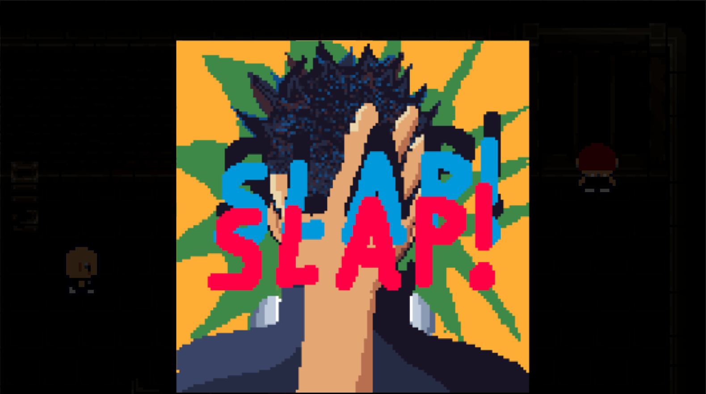
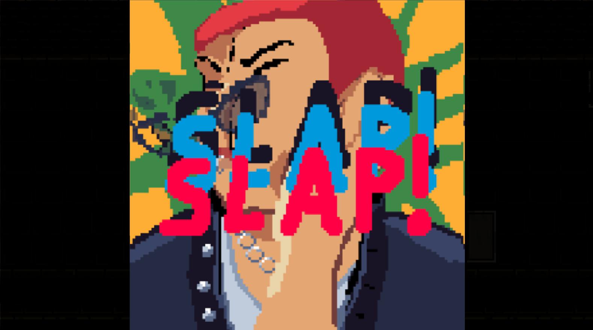
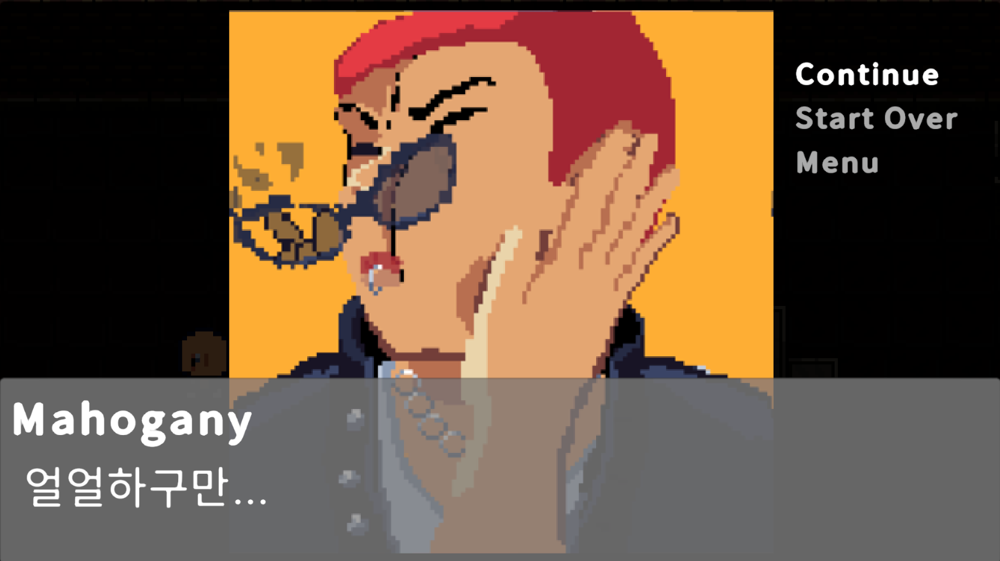
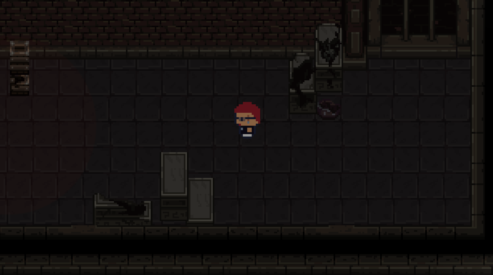
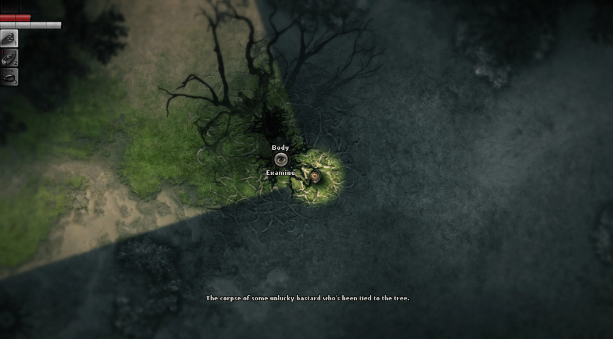
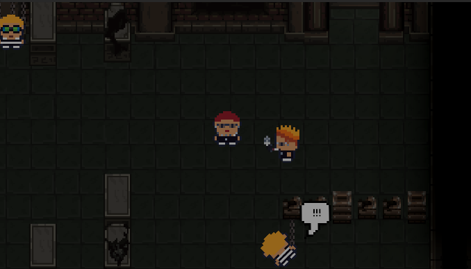
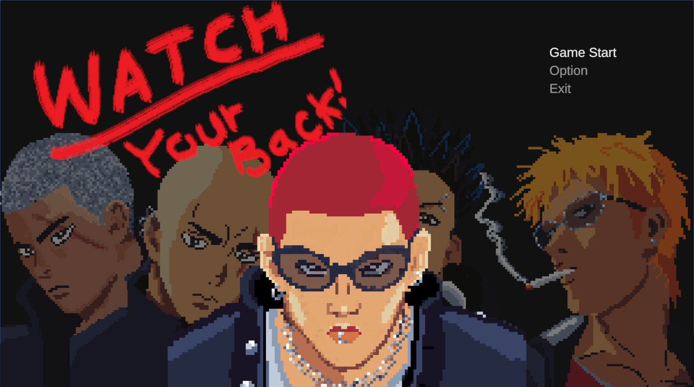

# Watch Your Back 게임 업데이트 기획서

## 1. 현행버전 회고
### 1.1 게임 장르: 2D 탑다운 잠입 & 액션 게임
### 1.2 핵심루프:

#### **인 게임 씬**

**핵심 루프**: "플레이어이의 적 관찰 → 은신 접근 → 뒤통수 처치" 한 사이클이 매 적마다 반복

적은 대기 - 순찰 (EnemyIdleState ↔ EnemyPatrolState) 사이를 오가며 정해진 곳을 순찰.

플레이어는 적의 시야박스와 동선을 관찰하며 사각지대로 접근하여 적의 피격 박스 (EnemyBackHurtBox)에 플레이어의 공격 판정이 닿으면 뒤통수 판정 호출 (OnBackHit())
→ 즉시 EnemyKnockDownState로 전환 (원킬)
반대로 적의 시야(SightBox)에 걸리면 추격 상태(EnemyChaseState) → 사거리 진입 시 공격 상태 (EnemyAttackState)로 전환되어 역으로 플레이어가 위협받음

--- 
- **승리 조건**: `Alleyman` → `Watchman` → `Ratman` → `Darkerman` 4명의 보스를 순서대로 처치.
  진짜 Darkerman을 쓰러뜨리면  → 엔딩 씬 → 게임 클리어

<진짜 Darkerman 뒷통수 컷씬>

<게임 클리어 씬>

- **패배 조건**: 적이 플레이어 추격 중에 `EnemyAttackHitBox`가 플레이어에게 닿으면 게임 오버

<플레이어 피격 컷씬>

<게임 오버>

---

### 1.3 만족했던 부분과 부족했던 부분
- **만족했던 부분**:
1. 게임 인트로 씬 연출 
2. 플레이어/적 넉다운 연출
3. 발걸음, 공격, 뒷통수 연출 씬 등의 음향 연출 

- **부족했던 부분**
1. 기획할 때는 잠입 게임이라고 했지만, 만들면서 액션 게임에 가깝게 피지컬이 중요한 게임이 되었음
2. 적 AI 의 행동이 자연스럽지 않음 
2. 적의 장애물 우회 기능의 미흡 (벽 끼임 현상)
3. 적이 플레이어 추격 시 재생되는 음악의 1회성 사용
4. 맵 디자인 부분에서 LDTK 사용하지 않고, 타일맵 단순 구현
5. 플레이어의 애니메이션 기반 공격 시 즉시 공격하지 않았음 
6. 적(EnemyStateManager)와 플레이어(PlayerMovement)의 한클래스의 기능이 너무 많이 붙어있음

### 1.4 첫 게임 후의 유저 피드백
1. Watchman 과 Ratman 의 보스 패턴이 유사한데, 
Ratman 의 쥐가 죽었을 때의 보스가 받는 이점이 생기면 좋겠다 (예를 들면, 쥐가 죽을 때마다 스피드가 빨라지는 )

2. 맵 장애물 구조의 콜라이더 디테일이 부족함, 시각적으로는 지나갈수있는 부분이 단순 콜라이더 적용으로 지나가지 못함
3. 적의 앞에 일정한 시야각을 만들어 그걸 표시한 후 거기서 그 시야각에 들어갔을 때 감지가 되는 시스템으로 구현했다면 조금 더 직관적이었을 것 같습니다 추가로 적 AI가 추격모드 - 순찰 모드 등으로 전환 될때 AI 위에 ! 나 ? 등을 표시해 상태전환도 있었다면 좋았을거 같습니다
4. 쿨타임이 있는 은신 스킬과 몬스터는 정해진 구역을 움직이되 플레이어의 발소리를 감지해서 "인식 게이지?"가 다 차오르면 그때 쫒아오는 로직이 있었으면 더 전략적이고 재밌었을 것 같습니다.

---

## 2. 업데이트 목표와 콘셉
### 2.1 업데이트의 목표
> 버그 픽스와 시야 시스템 개편, 게임의 재미를 더할 스킬 & 아이템 추가
 

### 2.2 업데이트 컨셉
> 잠입 게임의 정체성 확보, 죽은 적 AI 살리기, 게임 재미 더하기
### 2.3 업데이트 상세 내용 (시스템, 콘텐츠, UI, 피드백)

- ### **시스템**
    #### 1. 시야 시스템 변경 
  > 잠입 게임의 정체성을 살리기 위한 핵심 시스템, 시야 시스템을 바꿔야 산다! 
  
    <현재 시야 시스템>
    
    > 1. 게임 화면 기준으로 플레이어가 모든 오브젝트와 맵 환경을 볼 수 있음   
    > 2. 적의 시야 박스에 플레이어 콜라이더가 닿는 순간 추격

    <업데이트 될 시야 시스템> 게임 Darkwood 시야 시스템 스타일 구현
   
    > 1. 플레이어가 보는 시야각만 밝게 표현, 그 외 시야 사각지대는 볼 수 없음 
    > 2. 적의 시야 박스에 닿을 경우 발견 수치값을 증가시켜 발견 수치 최대값에 도달했을 때 추격으로 전환

      

      
  #### 2. 적 AI 시스템 
- 현재 적 AI 의 문제점 
  1. 순찰 - 추적 상태 도중 플레이어가 도망쳐서 시야에 없는 경우 이동 버그가 발생 
  2. 길 우회 시스템의 한계: 적의 장애물 감지 박스 콜라이더로 장애물을 감지해 길 우회 방향을 조정
  3. 히트 판정 개선: 플레이어가 먼저 공격했지만, 컷씬 재생 중에는 적이 비활성화 되지 않아 공격이 가능함

- 개선 방법
  1. 순찰과 길 우회 시스템의 문제를 A* 길찾기 시스템 기반으로 변경
  2. 히트 판정 매니저 class 로 역할 분리하여 히트 판정 개선 

--- 

- ### **콘텐츠**
1. 스킬 추가

| 스킬명 | 기능                       | 쿨타임 |
|--|--------------------------|-----|
| 연막탄 | 사용하면 특정 구역의 플레이어를 볼 수 없게 한다 | 15초 |
|  |                          ||

2. 아이템 추가:

| 아이템명  | 기능                                     | 사용 조건       |
|-------|----------------------------------------|-------------|
| 종이 상자 | 사용하면 적은 플레이어를 볼 수 없다. 움직이면 박스 아이템은 사라짐 | 추적 상태가 아닐 때 |  

 
    

---

## 3. UX FLOW
### 3.1 FLOW Chart

---

## 4. 화면 기획
### 4.1 주요화면 (플레이/ 메뉴/ 결과) 

- **플레이 화면**
  

- **메뉴 화면**
  

- ** 게임결과 **
  

### 4.2 카메라 연출 기획

- 적의 뒤통수 / 플레이어의 피격 컷씬 때 화면 흔들림 추가

---

## 5. 아트 스타일 가이드
- 현재 아트스타일
> 2D 픽셀 아트 기반으로 기존에 있는 에셋을 사용하지 않고 자체 제작으로 캐릭터 및 컷씬 연출
> 
> 현재의 아트 스타일에 자연스럽게 녹일 스킬이나 아이템, 맵 등의 에셋을 확보할 예정

- 적용대상:

| 종류       | 에셋 확보 루트        ||
|----------|-----------------|-|
| 신규 캐릭터   | 직접 제작 예정        ||
| 아이템 · 스킬 | 에셋 스토어 혹은 무료 에셋 ||
| 맵        |에셋 스토어 혹은 무료 에셋||
| UI       |에셋 스토어 혹은 무료 에셋||
- 
---

## 6. 에셋 요구서
### 6.1 필요 에셋 (캐릭터/ 배경 / 오브젝트 / UI / 이펙트)
### 6.2 에셋 리스트 (ID/ 에셋명 / 종류/ 규격 / 배치위치/ 연출 목적/ 확보 방법)

---

## 7. 음향 컨셉
### 7.1 현재 음향 구현 상태

| 종류  | 연출 목적           | 저작권   | 출처      |
|-----|-----------------|-------|---------|
| SFX | 공격 효과음 1 (플레이어) | 없음    | Pixaby  |
| SFX | 공격 효과음 2  (적)   | 없음    | Pixaby  |
| SFX | 뒤통수 치기 성공 효과음   | 없음    | Pixaby  |
| SFX | 발걸음 1 (플레이어)    | 없음    | Pixaby  |
| SFX | 발걸음 2 (적)       | 없음    | Pixaby  |
| SFX | 감시자 발견 소리(Hey!) | 없음    | Pixaby  |
| SFX | 넉다운 펑! 연출       | 확인필요  | 나루토     |
| SFX | 쥐 우는 소리         | 없음    | Pixaby  |
| SFX | 쥐 죽는 소리         | 없음    | Pixaby  |
| SFX | 메뉴 이동           | 확인 필요 | WOW SFX |
| SFX | 메뉴 선택           | 확인 필요 | WOW SFX |
| BGM | 메뉴 인트로          | 있음    | 나루토     |
| BGM | 엔딩 음악           | 있음    | 나루토     |
| BGM | 추격 상태 배경음       | 없음    | Pixaby  |
### 7.2 업데이트 음향 목표
>
### 7.3 음향 리스트 

