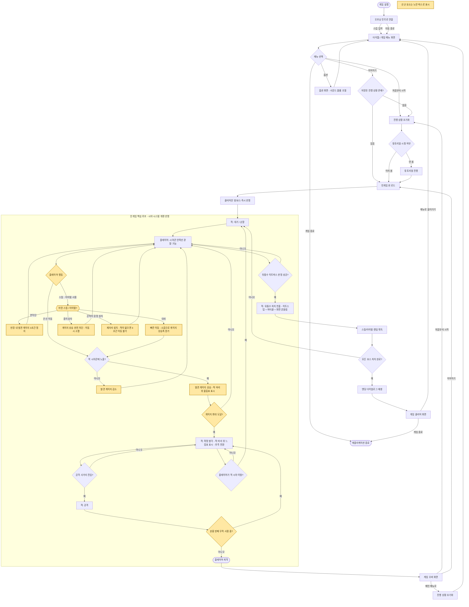
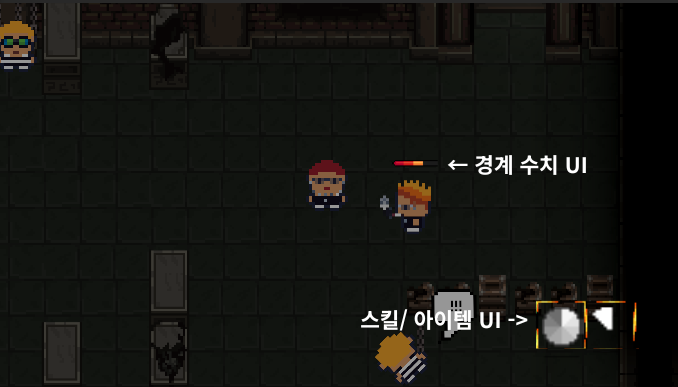
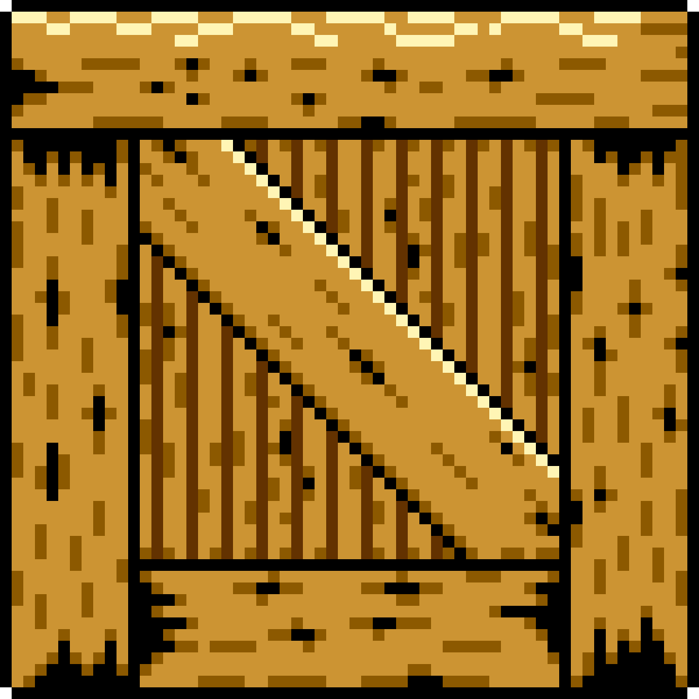
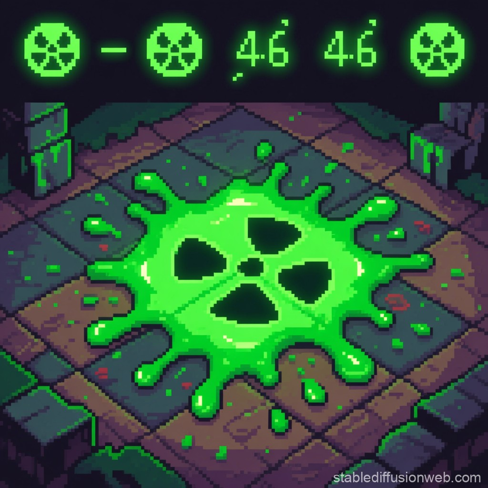
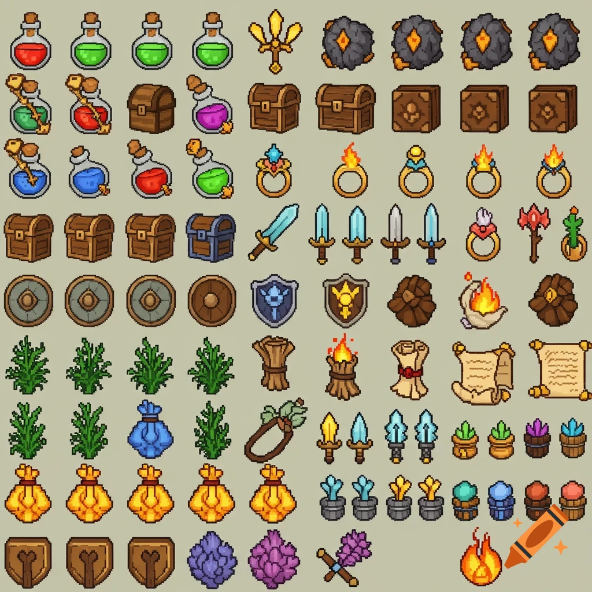
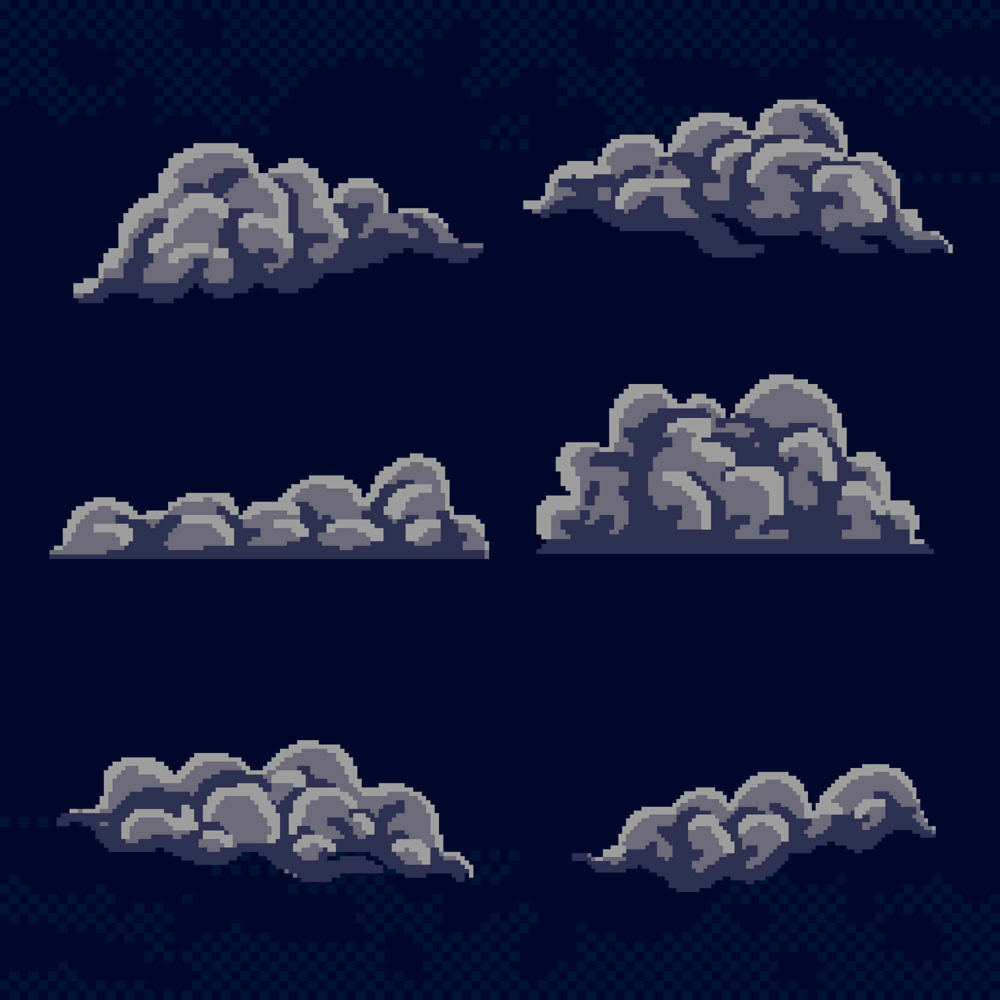

# Watch Your Back 게임 업데이트 기획서

## 1. 현행버전 회고
### 1.1 게임 장르: 2D 탑다운 잠입 & 액션 게임
### 1.2 핵심루프:

#### **인 게임 씬**

**핵심 루프**: `플레이어이의 적 관찰 → 은신 접근 → 뒤통수 처치` 한 사이클이 매 적마다 반복

적은 대기 - 순찰 `(EnemyIdleState ↔ EnemyPatrolState)` 사이를 오가며 정해진 곳을 순찰.

플레이어는 적의 시야박스와 동선을 관찰하며 사각지대로 접근하여 적의 피격 박스 `EnemyBackHurtBox`에 플레이어의 공격 판정이 닿으면 뒤통수 판정 호출 (OnBackHit())
→ 즉시 넉다운 상태`EnemyKnockDownState`로 전환 (원킬)
반대로 적의 시야`(SightBox)`에 걸리면 추격 상태`(EnemyChaseState)` → 사거리 진입 시 공격 상태 `(EnemyAttackState)`로 전환되어 역으로 플레이어가 위협받음

--- 
- **승리 조건**: `Alleyman` → `Watchman` → `Ratman` → `Darkerman` 
> 4명의 보스를 순서대로 처치.   진짜 Darkerman을 쓰러뜨리면  → 엔딩 씬 → 게임 클리어

<진짜 Darkerman 뒷통수 컷씬>

<게임 클리어 씬>

- **패배 조건**: 
> 적이 플레이어 추격 중에 적의 공격 히트 박스`EnemyAttackHitBox`가 플레이어에게 닿으면 게임 오버

<플레이어 피격 컷씬>

<게임 오버>

---

### 1.3 만족했던 부분과 부족했던 부분
- **만족했던 부분**:
1. 게임 인트로 씬 연출 
2. 플레이어/적 넉다운 연출
3. 발걸음, 공격, 뒷통수 연출 씬 등의 음향 연출 

- **부족했던 부분**

| 항목                | 추정 원인   |
|-------------------|---------|
| 잠입보다 액션 피지컬 게임이 됨 | 기획 및 구현 |
| 적 AI 행동 부자연스러움| 구현|
| 장애물 우회 미흡 (벽 끼임)  | 구현 (버그) |
| 추격 음악 1회성 사용| 구현 (버그) |
|LDTK 미사용, 타일맵 단순 구현| 일정|
|공격 애니메이션 딜레이| 구현|
|EnemyStateManager/PlayerMovement 책임 과다| 기획 & 일정 |

### 1.4 첫 게임 후의 유저 피드백
1. Watchman 과 Ratman 의 보스 패턴이 유사한데, 
Ratman 의 쥐가 죽었을 때의 보스가 받는 이점이 생기면 좋겠다 (예를 들면, 쥐가 죽을 때마다 스피드가 빨라지는 )

2. 맵 장애물 구조의 콜라이더 디테일이 부족함, 시각적으로는 지나갈수있는 부분이 단순 콜라이더 적용으로 지나가지 못함
3. 적의 앞에 일정한 시야각을 만들어 그걸 표시한 후 거기서 그 시야각에 들어갔을 때 감지가 되는 시스템으로 구현했다면 조금 더 직관적이었을 것 같습니다 추가로 적 AI가 추격모드 - 순찰 모드 등으로 전환 될때 AI 위에 ! 나 ? 등을 표시해 상태전환도 있었다면 좋았을거 같습니다
4. 쿨타임이 있는 은신 스킬과 몬스터는 정해진 구역을 움직이되 플레이어의 발소리를 감지해서 "인식 게이지?"가 다 차오르면 그때 쫒아오는 로직이 있었으면 더 전략적이고 재밌었을 것 같습니다.

---

## 2. 업데이트 목표와 콘셉
### 2.1 업데이트의 목표
> 버그 픽스와 시야 시스템 개편, 게임의 재미를 더할 스킬 & 아이템 추가
 

### 2.2 업데이트 컨셉
> 잠입 게임의 정체성 확보, 죽은 적 AI 살리기, 게임 재미 더하기
### 2.3 업데이트 상세 내용 (시스템, 콘텐츠, UI, 피드백)

- ### **시스템**
    #### 1. 시야 시스템 변경 
  > 잠입 게임의 정체성을 살리기 위한 핵심 시스템, 시야 시스템을 바꿔야 산다! 
  
    <현재 시야 시스템>
    
    > 1. 게임 화면 기준으로 플레이어가 모든 오브젝트와 맵 환경을 볼 수 있음   
    > 2. 적의 시야 박스에 플레이어 콜라이더가 닿는 순간 추격

    <업데이트 될 시야 시스템> 게임 Darkwood 시야 시스템 스타일 구현
   
    > 1. 플레이어가 보는 시야각만 밝게 표현, 그 외 시야 사각지대는 볼 수 없음 
    > 2. 적의 시야 박스에 닿을 경우 발견 수치값을 증가시켜 발견 수치 최대값에 도달했을 때 추격으로 전환

      

      
  #### 2. 적 AI 시스템 
- 현재 적 AI 의 문제점 
  1. 순찰 - 추적 상태 도중 플레이어가 도망쳐서 시야에 없는 경우 이동 버그가 발생 
  2. 길 우회 시스템의 한계: 적의 장애물 감지 박스 콜라이더로 장애물을 감지해 길 우회 방향을 조정
  3. 히트 판정 개선: 플레이어가 먼저 공격했지만, 컷씬 재생 중에는 적이 비활성화 되지 않아 공격이 가능함

- 개선 방법
  1. 순찰과 길 우회 시스템의 문제를 A* 길찾기 시스템 기반으로 변경
  2. 히트 판정 매니저 class 로 역할 분리하여 히트 판정 개선 

--- 

- ### **콘텐츠**
1. 스킬 추가

| 스킬명 | 기능                                 | 쿨타임 |
|-----|------------------------------------|-----|
| 연막탄 | 사용하면 적이 특정 구역의 플레이어를 3초간 볼 수 없게 한다 | 15초 |
| 대쉬  | 사용하면 바라보는 방향으로 빠르게 움직인다            | 10초 |
|     |                                    |

> 스킬은 하나만 선택 할 수 있다. 

2. 아이템 추가:

| 아이템명   | 기능                                     | 사용 조건         |
|--------|----------------------------------------|---------------|
| 숨기 상자  | 사용하면 적은 플레이어를 볼 수 없다. 움직이면 박스 아이템은 사라짐 | 추적 상태가 아닐 때   |
| 끈적이 함정 | 적이 밟게 되면 3초간 이동 할 수 없다                 | 특수 조건없이 사용 가능 |
| 분홍 방패  | 사용하면 1초간 적의 피격을 무시한다                   | 특수 조건없이 사용 가능 |              |

 > 아이템 획득은 보스 처치 후 랜덤으로 획득하는 방식, 재사용이 불가하고 사용하면 소모된다.
    
- ### **UI**
> 발견 게이지 UI 추가 (적 머리 위 수치 표시), 스킬/아이템 쿨타임 슬롯 UI 추가
> :유저 피드백 3번, 4번 반영

- ### **피드백**
> 

---

## 3. UX FLOW
### 3.1 FLOW Chart

---

## 4. 화면 기획
### 4.1 주요화면 (플레이/ 메뉴/ 결과) 

- **플레이 화면**

  

- **메뉴 화면**
  

- **게임결과**
  

### 4.2 카메라 연출 기획

- 적의 뒤통수 / 플레이어의 피격 컷씬 때 화면 흔들림 추가

---

## 5. 아트 스타일 가이드
### 현재 아트스타일 (2D 픽셀아트 기반)
---
- **종이상자**
  
---
- **끈적이 함정**
- > 출처: https://stablediffusionweb.com/ko/image/50774332-toxic-floor-tile-animation?source_site=sdw&source_page_type=prompt_page&source_page_path=%2Fko%2Fprompts%2Fpixel-art-of-green-slime-facing-left&source_action=view_prompt_image&source_image_slug=50774332-toxic-floor-tile-animation&source_prompt_slug=pixel-art-of-green-slime-facing-left

   
---
- **분홍방패**
- >출처: https://www.craiyon.com/en/image/RUYlg0z9SOKN1mm8TUGQpg
  
- 
---
- **연막탄**
> 출처: https://www.magnific.com/free-vector/flat-design-pixel-art-cloud-illustration_38215920.htm
  
---
- **대쉬**
  

- 적용대상:

| 종류       | 에셋 확보 루트        |
|----------|-----------------|
| 신규 캐릭터   | 직접 제작 예정        |
| 아이템 · 스킬 | 에셋 스토어 혹은 무료 에셋 |
| 맵        |에셋 스토어 혹은 무료 에셋|
| UI       |에셋 스토어 혹은 무료 에셋|

---

## 6. 에셋 요구서
### 6.1 필요 에셋 (캐릭터/ 배경 / 오브젝트 / UI / 이펙트)
- 캐릭터 / 배경 : 캐릭터 대기 상태 모션 추가 / 배경 추가 예정 없음
- 오브젝트: 아이템: 종이 상자, 끈적이 함정, 분홍 방패
- 이펙트: 스킬: 대쉬, 연막탄
- UI: 스킬/아이템 슬롯 아이콘, 쿨타임 게이지, 신규 발견(인지) 게이지 UI
### 6.2 에셋 리스트 (ID/ 에셋명 / 종류/ 규격 / 배치위치/ 연출 목적/ 확보 방법)

| ID | 에셋명             |  종류  | 규격 |         배치위치          |     연출목적      |                             확보방법                             |
|----|-----------------|:----:|---|:---------------------:|:-------------:|:------------------------------------------------------------:|
| ITM-01 | 종이상자 | 오브젝트 | 32×32px |    인게임 씬 (바닥 배치형)     | 추적 상태가 아닐 때만 사용 가능하게 하여, 플레이어가 위험을 미리 계산하고 은신 타이밍을 스스로 설계하도록 유도 |       직접 제작 (무료 레퍼런스 참고: dani maccari Cardboard Boxes)       |
| ITM-02 | 끈적이 함정 | 오브젝트 | 32×32px |    인게임 씬 (바닥 배치형)     | 적의 이동을 3초간 봉쇄해, 잠입에 실패했을 때도 재정비할 탈출 기회를 제공 |           직접 제작 (질감 참고: Free Slime Mobs Pixel Art)           |
| ITM-03 | 분홍 방패 | 오브젝트 + 버프 이펙트 | 32×32px (아이콘) / 캐릭터 주변 오라 |  인게임 씬 (플레이어 주변 이펙트)  | 1초간 무적 판정을 시각적으로 명확히 표시해, 실수로 인한 억울한 사망(원킬 시스템 특성상 리스크가 큼)을 방지 |         직접 제작 (형태 참고: OpenGameArt Shields Pixel art)         |
| EFX-01 | 연막탄 | 이펙트 (파티클) | 반경 2타일 / 지속 3초 | 인게임 씬 (플레이어 시전 위치 중심) | 특정 구역의 시야를 일시 차단해 위기 탈출 및 재잠입 기회를 제공, 전략적 선택지를 확장 |itch.io 무료 에셋 https://bdragon1727.itch.io/  |
| EFX-02 | 대쉬 | 이펙트 (잔상/트레일) | 이동거리 3타일 / 지속 0.2초 |  인게임 씬 (플레이어 이동 경로)   | 짧은 순간 이동에 속도감을 부여해 위기 상황에서의 회피 조작감을 강화 |itch.io 무료 에셋 https://bdragon1727.itch.io/  |
| UI-01 | 스킬 슬롯 아이콘 | UI | 32×32px |     화면 하단 우측 HUD      | 현재 장착한 스킬(연막탄/대쉬) 종류를 즉시 인지시켜 조작 실수를 감소 |itch.io 무료 에셋 https://bdragon1727.itch.io/  |
| UI-02 | 아이템 슬롯 아이콘 | UI | 32×32px |     화면 하단 우측 HUD      | 보유 중인 소모 아이템 종류와 잔여 여부를 표시해 자원 관리를 유도 |itch.io 무료 에셋 https://bdragon1727.itch.io/|
| UI-03 | 쿨타임 게이지 (라디얼) | UI | 32×32px 오버레이 |    스킬/아이템 슬롯 아이콘 위    | 재사용 가능 시점을 직관적으로 표시해 스킬 남용을 방지하고 타이밍 전략을 유도 |            .io 무료 에셋 https://bdragon1727.itch.io/            |
| UI-04 | 발견(인지) 게이지 | UI | 폭 40px 바 형태 |   적 머리 위 월드스페이스 UI    | 플레이어가 "언제까지 숨어야 안전한지"를 실시간으로 판단할 근거를 제공 (시야 시스템 개편과 직결) |          itch.io 무료 에셋 https://bdragon1727.itch.io/          |
---

## 7. 음향 컨셉

### 7.1 현재 음향 진단
- 기본적인 액션/UI 효과음(공격, 발걸음, 넉다운, 커서 이동 등)은 상황별로 갖춰져 있으나, **추격 BGM이 크로스페이드 루프 로직의 카운터 오류로 첫 플레이 이후 재생되지 않는 버그**가 있어(1.3 참조) 긴장감이 지속되지 못함.
- 환경음(발소리 외의 배경 소음, 공간감)이 전무해 맵이 텅 빈 느낌을 준다.
- 넉다운 SFX, 메뉴 인트로/엔딩 BGM은 애니메이션(나루토) 원곡을 그대로 사용 중이며, 저작권 문제가 있어 정식 배포 시 리스크가 있다.
- 무엇보다, 지금까지의 사운드는 대부분 "기능을 알리는 신호"로만 설계되어 있고, **이 게임 특유의 톤(악당들의 유쾌한 복수극)을 사운드가 대변하고 있지 않다.**

### 7.2 업데이트 음향 콘셉트
> **"무서운 잠입이 아니라, 능청스러운 악당들의 유쾌한 뒤통수 치기 게임임을 사운드로 증명한다."**
> 원 히트 원 킬의 팽팽한 긴장감은 유지하되, 그 안에 장난기와 복수의 감정을 함께 담아 "무겁지 않은 잠입극"의 톤을 완성한다.

**컨셉 키워드 (3개)**
1. **코믹 바이브** — 공포보다는 유쾌한 도둑/악당물의 톤
2. **리듬감 있는 긴장감** — 앰비언트보다 타악기·베이스 중심으로 "쫄깃하게" 조이는 긴장
3. **과장된 카타르시스** — 뒤통수 성공/보스 처치 순간은 코믹하게 부풀려 표현

### 7.3 상황별 사운드 컨셉 및 레퍼런스

| 상황 | 컨셉/의도                               | BGM·SFX 방향                                    | 레퍼런스 | 비고 |
|---|-------------------------------------|-----------------------------------------------|---|---|
| 메뉴 | 앞으로 벌어질 소동을 예고하는 가벼운 도입             | 스윙/재즈 펑크 느낌의 경쾌한 루프 BGM                       | *Sly Cooper* 시리즈 메뉴 테마 (장르 참고용) | 기존 나루토 트랙 대체 필요 |
| 일반(순찰) | 평온하지만 은근한 장난기가 깔린 배경                | 로우파이 베이스 + 가벼운 퍼커션의 미니멀 루프 + 발소리·문소리 등 환경음 추가 | Kevin MacLeod - *Sneaky Snitch* (CC 라이선스, 유쾌한 잠입 톤의 대표 레퍼런스) | 신규 추가 항목 |
| 위기 (발견 게이지 상승 중) | "들킬락 말락"하는 순간의 조여드는 리듬              | 타악기 비중 증가 + 템포 서서히 상승, 게이지 % 에 맞춰 레이어 추가      | Silent Partner - *Monkey Business* (YouTube Audio Library, 로열티프리) | 게이지 시스템(2장)과 직접 연동 |
| 보스전 | 위협적이되 우스꽝스러움을 잃지 않는 액션감             | 브라스/신스 스탭 강조, 전투 시작 시 임팩트 스팅어                 | Persona 5 전투 BGM (브라스 스탭 활용 방식 참고용) | 나루토 대체곡 우선순위 1순위 |
| 결과 (성공/실패) | 성공은 통쾌하게, 실패는 복수의 감정을 끓어올릴 수 있도록 한다 | 성공: 짧고 과장된 팡파레 / 실패: 짧은 정적| 클래식 카툰 SFX (Looney Tunes류 과장 효과음 톤 참고용) | 넉다운 SFX 대체 후보 |

### 7.4 아트 스타일과의 일관성 논증
현재 아트 방향(5장)은 자체 제작 2D 픽셀 캐릭터로, 악당들을 위협적이라기보다 **귀엽고 만화적인 실루엣**으로 표현하고 있다. 이 게임의 정체성은 "무서운 악당"이 아니라 "능청스러운 안티히어로의 복수극"에 있으므로, 사운드 역시 다크 앰비언트나 서스펜스 스코어 대신 **타악기·베이스 중심의 리듬감**으로 긴장감을 표현하는 편이 캐릭터 디자인과 톤이 어긋나지 않는다. 특히 뒤통수 성공 연출(4.2 카메라 흔들림)과 결합될 "과장된 팡파레" SFX는, 잠입의 팽팽함과 성공의 유쾌한 해소감을 동시에 살려 픽셀아트 특유의 코믹함과 자연스럽게 이어진다.

### 7.5 보완 필요 사항
- 🔴 **저작권 리스크 우선 해소**: 넉다운 SFX, 메뉴/보스전 BGM 등 나루토 원곡 사용 트랙은 위 표의 레퍼런스처럼 톤이 유사한 로열티프리/CC 라이선스 곡으로 우선 교체 필요
- 🟡 추격 BGM 크로스페이드 버그(7.1)는 사운드 콘셉트 이전에 반드시 선행 수정
- 🟡 환경음(발소리 반향, 공간 앰비언스) 신규 추가로 "빈 맵" 느낌 해소
